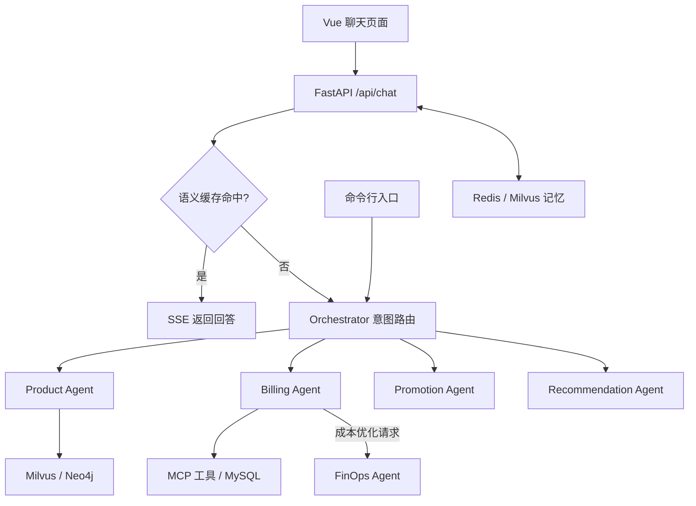

# CloudAgent

基于 LangChain、LangGraph 和 MCP 的多智能体云服务助手，提供云产品咨询、账单与资源查询、产品推荐、推广物料和成本优化建议。项目包含 Vue 聊天页面、FastAPI 接口和命令行入口，适合学习多智能体编排、工具调用与知识库检索。

## 功能与技术栈

| 模块 | 实现 |
| --- | --- |
| 意图路由 | Orchestrator 根据问题选择业务 Agent |
| 产品咨询 | 结合 Milvus 文档检索与 Neo4j 知识图谱回答产品问题 |
| 账单与资源 | 通过 MCP 工具查询 MySQL 中的订单、实例和使用情况 |
| 产品推荐 | 根据需求提供产品选型建议 |
| 推广支持 | 查询推广物料，调用模型生成海报 |
| 成本优化 | Billing Agent 获取资源信息后，将状态交给 FinOps Agent 分析 |
| 会话记忆 | Redis 保存短期对话，Milvus 存储长期偏好；CLI 支持偏好提取 |
| 聊天接口 | FastAPI 提供 SSE 响应，包含语义缓存读取逻辑 |
| 前端 | Vue 3、TypeScript、Vite、Element Plus、Markdown 展示 |
| 模型 | DashScope / 通义千问，默认配置为 `qwen-plus` |

当前实现包含演示产品目录和推广数据，业务查询使用本地数据库，并非已接入真实云厂商账户。Web 接口接收调用方传入的 `user_id`，尚未提供登录认证，不能将其视为生产环境的身份验证机制。

## 工作流程



Web 服务在第一次聊天请求时初始化 Agent、记忆和缓存，因此首次响应可能较慢。目前 SSE 是在取得完整回答后分块发送，并非模型逐 token 直传。

## 目录结构

```text
cloud_agent/
├── agent/
│   ├── agents/                 # 路由与各业务 Agent
│   ├── config/                 # 环境配置加载、MCP 服务定义
│   ├── core/                   # 图编排、记忆、图谱与 MCP 基础模块
│   ├── database/               # MySQL 演示数据初始化 SQL
│   ├── mcp_servers/            # 云平台业务工具服务
│   ├── test/                   # 知识库导入和查询脚本
│   ├── tools/                  # 向量检索与图谱查询工具
│   ├── .env.example            # 应用配置模板
│   ├── requirements-windows.txt
│   └── main.py                 # CLI 入口
├── app/                        # FastAPI 接口、聊天服务与缓存
├── docs/                       # Docker Compose、环境模板与搭建说明
├── front/cloud_agent/          # Vue 前端
└── README.md
```

`mock_data/` 为本地知识库资料目录，已加入 `.gitignore`，不随当前仓库版本发布。克隆后需自行准备知识库文档，或连接已初始化的数据库。`agent/database/init_mock_data.sql` 是独立的业务数据库初始化脚本，仍保留在仓库中。

## 本地运行（Windows PowerShell）

以下命令除明确切换目录的步骤外，均在项目根目录执行。需要 Git、Python 环境、Docker Desktop（Linux containers），以及满足前端 `package.json` 要求的 Node.js：`^20.19.0 || >=22.12.0`。下面使用 Python 3.11 的 Conda 环境。

### 1. 获取源码与安装依赖

```powershell
git clone https://github.com/clear-eyes/cloud_agent.git
Set-Location .\cloud_agent

conda create --name multi_agent python=3.11 -y
conda activate multi_agent
python -m pip install --upgrade pip
python -m pip install -r .\agent\requirements-windows.txt
```

`requirements-windows.txt` 包含基础依赖以及 FastAPI、数据库客户端和源码使用的 LangChain 集成。

### 2. 创建本地配置

首次运行时复制模板；已有配置则直接编辑，避免覆盖凭据：

```powershell
if (!(Test-Path .\agent\.env)) {
    Copy-Item .\agent\.env.example .\agent\.env
}
if (!(Test-Path .\docs\.env.docker)) {
    Copy-Item .\docs\.env.docker.example .\docs\.env.docker
}
notepad .\agent\.env
notepad .\docs\.env.docker
```

| 应用变量 | 配置说明 |
| --- | --- |
| `DASHSCOPE_API_KEY` | 有效的 DashScope API Key，用于对话和 Embedding 等调用 |
| `MODEL` / `BASE_URL` | 默认模型 `qwen-plus` 和 DashScope 兼容接口地址 |
| `REDIS_URL` | Redis 连接地址，密码须与容器配置一致 |
| `MYSQL_HOST` / `MYSQL_PORT` | MySQL 地址与端口，默认使用本机服务 |
| `MYSQL_USER` / `MYSQL_PASSWORD` / `MYSQL_DATABASE` | 应用数据库账户、密码与数据库名 |
| `MILVUS_HOST` / `MILVUS_PORT` | Milvus 地址与端口，默认 `localhost:19530` |
| `NEO4J_URI` / `NEO4J_USER` / `NEO4J_PASSWORD` | Neo4j 连接信息，密码须与容器配置一致 |
| `REDIS_TTL` / `LOG_LEVEL` | 短期记忆有效期（秒）与日志级别 |

模板中的 `your_*` 是占位符，需要替换。真实 `.env` 文件不会提交到 Git。

### 3. 启动基础服务

先启动 Docker Desktop，然后执行：

```powershell
docker compose --env-file .\docs\.env.docker -f .\docs\docker-compose.windows.yml up -d
docker compose --env-file .\docs\.env.docker -f .\docs\docker-compose.windows.yml ps
```

默认启动 Redis、Milvus 及其 etcd/MinIO 依赖、Neo4j 和 Attu。MySQL 默认使用本机已安装的服务；没有本机 MySQL 时，可启用 Docker 版本，确保端口 `3306` 未被占用：

```powershell
docker compose --env-file .\docs\.env.docker -f .\docs\docker-compose.windows.yml --profile mysql-docker up -d
```

PostgreSQL 为可选 profile，当前应用代码未使用，无需启动。

### 4. 准备业务数据与知识库

**MySQL 业务数据：** 在数据库客户端中连接配置的数据库（默认 `mydb`），执行 `agent/database/init_mock_data.sql`，建立演示订单和实例数据。使用本机 MySQL 时，需先创建数据库和应用账户，并授予相应权限。

该 SQL 包含 `TRUNCATE TABLE`，会清空对应演示表已有数据，仅用于可重置的开发数据库。

**知识库文档：** 自行准备云产品说明、操作指南等 Markdown 文件。可以放在被 Git 忽略的 `mock_data/` 中，也可以放在仓库外。下面以仓库外的资料目录为例，请先替换为实际路径：

```powershell
$knowledgeDir = "E:\CloudAgentKnowledge"
$knowledgeFile = Join-Path $knowledgeDir "ecs_product_info.md"

# 将 Markdown 目录导入 Milvus
python .\agent\test\milvus_rag.py --ingest --data-dir $knowledgeDir

# 从指定 Markdown 文件抽取实体与关系，导入 Neo4j
python .\agent\test\build_kg.py $knowledgeFile
```

Milvus 的 `--ingest` 会覆盖目标集合并重新计算 Embedding；日常查询不需要重复导入。导入需要有效模型凭据及网络连接，会产生模型调用费用。未准备知识库时，产品检索功能无法获得相应文档和图谱结果。

### 5. 启动后端

在已激活 Python 环境的项目根目录执行：

```powershell
python -m app.app_main
```

接口地址为 `http://127.0.0.1:5000`，Swagger 文档为 [http://127.0.0.1:5000/docs](http://127.0.0.1:5000/docs)。文档页面可访问只说明 HTTP 服务已启动，实际聊天还依赖模型与数据库初始化成功。

### 6. 启动前端

另开 PowerShell，在项目根目录执行：

```powershell
Set-Location .\front\cloud_agent
npm ci
npm run dev
```

访问终端显示的地址，通常为 [http://localhost:5173](http://localhost:5173)。前端目前固定请求 `http://127.0.0.1:5000/api/chat`；更换后端地址时，需同步修改 `front/cloud_agent/src/App.vue` 中的请求地址。

### 7. 命令行使用

也可以不启动前端和 FastAPI，在项目根目录、已激活的 Python 环境中运行：

```powershell
# 交互对话，输入 quit / exit / q 退出
python -m agent.main

# 单次提问
python -m agent.main --query "什么是 VPC？"

# 指定用户与会话
python -m agent.main --user user_1001 --session demo_session --query "查询我的云资源实例"
```

## 聊天接口

`POST /api/chat`，请求类型为 `application/json`：

```json
{
  "query": "帮我分析云资源成本",
  "user_id": "user_1001",
  "session_id": "demo_session"
}
```

`query` 必填；`user_id` 默认 `user_1001`，`session_id` 默认 `default_session`。同一会话应保持相同的用户和会话标识。

返回类型为 `text/event-stream`，事件示例：

```text
data: {"content": "回答片段"}

data: {"done": true}
```

客户端应逐条解析 `data:` 后的 JSON，将 `content` 拼接显示，收到 `done: true` 后结束。

## 开发与排查

```powershell
# 在前端目录执行类型检查与构建
Set-Location .\front\cloud_agent
npm run type-check
npm run build
```

在项目根目录查看基础服务日志或停止容器：

```powershell
docker compose --env-file .\docs\.env.docker -f .\docs\docker-compose.windows.yml logs --tail 100
docker compose --env-file .\docs\.env.docker -f .\docs\docker-compose.windows.yml --profile mysql-docker down
```

`down` 保留数据库命名卷。修改配置文件中的密码不会自动修改已初始化数据库的账户密码。

| 现象 | 检查方向 |
| --- | --- |
| 前端无法请求后端 | 确认后端监听 `5000`，以及页面中的请求地址正确 |
| 首次聊天等待较久 | 查看后端终端，检查模型调用及 Redis、Milvus 等初始化状态 |
| 数据库连接失败 | 检查容器状态、端口、应用 `.env` 与实际账户密码是否一致 |
| 文档导入提示文件不存在 | 仓库不提供 `mock_data/`，请传入自己的文件或目录路径 |
| 产品检索无结果 | 确认 Markdown 已导入 Milvus，图谱数据已导入 Neo4j |
| 账单查询无数据 | 确认 MySQL 已初始化，且查询用户与演示数据中的用户一致 |

更多本机环境说明见 [Windows 环境搭建文档](docs/环境搭建-Windows.md)。该文档中的部分旧路径使用 `cloudagent/`，本仓库实际 Compose 文件位于 `docs/`，目录与命令以本 README 为准。
